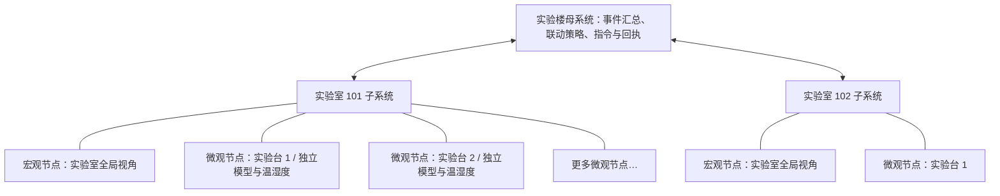

# 分层视觉干预监测系统：升级说明与操作教程

升级日期：2026-10-22。项目原文件夹名称保留，Mac 新入口默认打开分层母系统；仓库原有 desktop、edge、headless 三种模式保留。

## 1. 现在的系统是什么

原系统是一台电脑处理一个宏观画面与一个微观画面。升级后，系统以“实验楼—实验室—实验台”为组织结构。

- **实验台微观节点**：拥有自己的视频源、模型配置和温湿度数据，形成该实验台的局部风险证据。
- **实验室子系统**：拥有一个宏观节点，汇总其下多个微观节点；把实验室整体的人员存在/无人值守线索与每个实验台自己的证据结合。
- **实验楼母系统**：接收实验室事件，按配置向目标实验室下达报警、断电请求，收集执行结果并保存记录。

一个宏观节点配一个微观节点，仍然是合法配置，因此原来的非对称双视角结构成为整个分层系统的最小实例。这里的“宏观/微观”表示覆盖范围与任务分工，不是立体深度重建的双目几何算法。



默认演示包含 2 间实验室、3 个实验台，共 5 路视觉通道。通道数量由配置决定，不再写死为两路。

## 2. 先启动并认识界面

在 Finder 中双击项目根目录的 **一键启动_macOS.command**。沿用已经装好的独立环境，不需要重新安装依赖。

- 左侧树：母系统、各实验室、宏观节点与微观实验台。
- “实验室监控与演练”：显示当前选中实验室的宏观画面和所有微观画面；微观画面超过一屏时向下滚动。
- “楼宇事件与跨实验室联动”：显示事件、来源、证据、母系统指令与执行回执。
- “拓扑与联动策略 JSON”：高级配置，包括联动范围、动作、无人计时、数据有效期等。

默认全部视觉源和执行器处于模拟模式。模拟画面明确写有 SIMULATION，画面下方标注“场景注入，未运行视觉模型”。这方便只有电脑时演示架构，不代表火焰识别已经训练完成。

需要原来的界面时，双击 **原单实验室界面_macOS.command**；也可在命令行使用 `python run_app.py --mode desktop`。旧版操作教程对应这个兼容入口。

## 3. 演示一：一间实验室联动另一间实验室

1. 选中“实验室 101”。
2. 点击“演练火情 → 触发楼宇联动”。
3. 顶部进入红色紧急状态，左侧两间实验室都显示联动报警。
4. 打开“楼宇事件与跨实验室联动”，可以看到来源是实验室 101，证据来源是 `simulation`。
5. 默认会产生四条指令：101 报警、101 断电、102 报警、102 断电。每条都有自己的结果，默认结果为“模拟执行完成，未操作硬件”。
6. 切换到“实验室 102”，可以看到它因楼宇联动而报警，即使它自己的画面没有火情。

同一事件持续存在时，系统不会每一帧重复下发指令。指令的唯一键由“事件 ID、目标实验室、动作”组成。

结束演练：回到 101，点击“解除本实验室全部模拟危险”，等待事件的危险条件变为“已解除”，再点击“确认已解除的告警”。需要重新演示时，可再点击“复位模拟断电记录”。

**确认告警不会发出恢复供电指令。** 真实串口发送、发送失败或结果未知的记录，也不能作为模拟记录复位。

## 4. 演示二：一个宏观节点照看多个实验台

1. 在 101 的宏观区域取消勾选“演练：宏观有人值守”。
2. 只勾选“实验台 2”里的“演练：加热设备存在”。
3. 把实验台 2 的模拟温度调到 60℃，实验台 1 保持 25℃。
4. 默认无人计时 5 秒后，系统产生“无人值守高温加热风险”事件。
5. 双击事件可查看证据，事件节点应为实验台 2。该事件只执行本实验室的报警与断电请求，不按火情规则扩散到另一间实验室。

这段演示使用了三种线索：实验室宏观无人值守、同一实验台的加热设备、同一实验台的高温。不同实验台的数据不会被拼在一起。例如，实验台 1 低温但检测到加热设备，实验台 2 高温但只检测到烧杯，不能组成同一台的高温加热风险。

仓库默认所有实验台均使用新版手动模拟温湿度，不需要另开仿真器。高级配置仍保留对早期原型 IPC 温湿度文件的兼容入口。

## 5. 新增实验室或微观摄像头

- **新增实验室**：左侧点击“新增实验室”。系统为它创建一个宏观节点和一个微观实验台，初始均为模拟模式。
- **新增微观节点**：先选择目标实验室，再点击“新增微观实验台”。该实验室的宏观节点会同时服务新增节点。
- **配置模型与画面**：在树中选中宏观节点或微观实验台，点击“配置选中通道/模型”。选中实验室本身时，配置的是该实验室的宏观节点与断电执行器。
- **删除节点**：允许删除实验室或实验台，但整套系统至少保留一间实验室，每间实验室至少保留一个微观实验台；宏观节点属于实验室本身，不能单独删除。

保存后自动校验配置、停止原工作线程并重新加载。有未确认事件时会阻止调整拓扑，避免把事件所属节点直接删掉。

每个微观节点可以使用不同的 `.pt` 检测模型；也可以复用同一份模型权重。复用权重时，底层只加载一份模型，并通过锁协调推理，避免为每个实验台复制模型占用内存。**共享权重不等于共享实验台状态**：画面、温湿度、事件来源仍然独立。

## 6. 接入真实视频与模型

每个通道支持：

| 来源 | 填写内容 | 行为 |
| --- | --- | --- |
| 模拟演练 | 可留空 | 生成明确标注的演练画面，不调用 YOLO |
| USB 摄像头 | 0、1、2 等索引 | 只打开指定设备；失败不会偷偷扫描另一台摄像头 |
| 本地视频 | 文件路径 | 逐帧读取并循环播放 |
| 静态图片 | 文件路径 | 周期性运行真实模型，适合验证模型接入 |
| 网络 RTSP/HTTP | 视频流 URL | 使用 OpenCV/FFmpeg 读取流，设置打开与读取超时 |

不同物理视角必须分配不同 USB 索引。配置会拒绝把同一个索引重复分配到多个节点，以免把同一画面冒充两个视角。文件路径有中文、空格均可；配置里的相对路径以 `labguard` 为基准。

模型必须是能由当前 Ultralytics 加载的 **目标检测模型**。模型加载或推理失败时，通道显示异常并重试；新版不使用 MockYOLO 假装识别成功。真实执行器实验室不允许配置模拟视觉或模拟温湿度；模拟来源事件也不会操作真实目标串口。

可配置该模型哪些类别代表“人员存在证据”“加热设备”“火焰/烟雾”。标签采用忽略大小写、下划线转空格后的完整匹配，不使用随意的子字符串匹配。

### 当前两份权重的能力边界

- `ppe_best.pt`：12 类，属于防护用品、穿戴缺失、饮食等类别。新版把这些防护/行为目标作为实验室人员存在的间接线索；这不能替代专用人体检测和具体工位人员关联。
- `chem_best.pt`：14 类化学容器与器材，没有酒精灯、加热板、火焰或烟雾类别。
- 因此，真实视频中的自动火情与加热设备判断，需要另接对应类别的检测权重，并正确填写类别映射。**本次完成的是接入框架与联动实现，没有凭空新增训练好的火焰检测模型。**
- 单独出现烧杯、烧瓶不再直接等同于“正在加热”，因此原有基于容器的粗糙推断已在新版决策中收紧。

宏观无人值守目前作用于整个实验室，而不是对每个实验台单独匹配操作人员。只要实验室宏观视角仍有人员存在证据，就不会把该实验室所有实验台直接判为无人值守。

## 7. 修改母系统联动策略

在第三个标签页找到：

```json
"fire_linkage": {
  "targets": "all",
  "actions": ["alarm", "power_off"]
}
```

含义是：火情发生后，母系统对所有实验室执行软件报警与断电请求。来源实验室本身始终先执行本地措施。

若只希望另一个实验室收到报警，可以改为：

```json
"fire_linkage": {
  "targets": ["lab-102"],
  "actions": ["alarm"]
}
```

目标列表填写实验室 **ID**，不是显示名称。配置会检查 ID 是否存在。`all` 会自动覆盖以后新增的实验室；显式列表只覆盖列表中的实验室。

规则默认值：无人计时 5 秒、数据有效期 8 秒、高温阈值 55℃、高湿阈值 80%。超过有效期的视觉/温湿度不会继续作为当前风险证据。摄像头异常或恢复后的长时间断档会重新开始无人计时。

## 8. 真实传感器和执行器接口

每个实验台可独立配置串口温湿度来源，支持 `TEMP:27.6,HUMI:69.2`、`27.6,69.2`、`{"temp":27.6,"humi":69.2}` 等两数格式。无有效数据时会过期显示未知，不自动伪装成真实测量。传感器端口与执行器端口不得重复占用。

每间实验室有独立执行器配置，默认 `simulation`。选择真实串口时，复用仓库现有 `LabSafetyMonitor/serial_comm.py` 的 **AA 55 + SEQ + CMD + CRC16-CCITT** 协议和 ACK 重试；仅打开该实验室明确配置的端口，禁止自动扫描成其他节点。

执行结果区分：`SIMULATED`（模拟）、`SOFTWARE_ALARM`（软件报警）、`PENDING`（待执行）、`ACKNOWLEDGED`（下位机已确认断电指令）、`FAILED`（失败）与 `UNKNOWN`（进程中断、结果待核查）。收到 ACK 不等于完成独立电压测量，恢复供电仍必须现场操作。本分层功能没有通电接口。

当前断电请求粒度为实验室，没有增加每张实验台的继电器寻址协议。真实传感器、固件和多实验室布线仍需现场验证。

模拟事件永不访问真实执行器。人工火情报告可能触发真实串口，界面会说明影响并要求确认。分层审计记录也通过仓库的统一 `events.log()` 留痕；独立 JSONL 用于楼宇事件与指令恢复，不替换原有单实验室事件库。

## 9. 事件、恢复与数据文件

持久化目录：`labguard/runtime/hierarchy/`。

- `events.jsonl`：追加记录上报事件、联动指令、执行回执、危险条件变化与人工确认。
- `state.json`：保存事件、人工火情报告、指令状态和断电记录，使用临时文件替换方式更新。
- `runtime.lock`：独占运行锁，避免两个母系统同时写同一目录；进程退出或崩溃时由操作系统释放锁。
- 界面“导出事件、证据与回执”：生成可查看的 JSON 文件，方便检查是哪间实验室、哪个实验台、什么证据触发了联动。

重启保留未确认事件、人工火情报告和断电记录，不因关掉窗口就当作危险解除。人工报告的火情必须明确点击解除，不会随重启消失。重启后需要重新获取证据，才能确认危险已经解除。软件不会自动恢复供电，也不会把未完成的串口指令直接当作执行成功。

启动日志仍保存在 `.macos-runtime/logs/`。真实串口与摄像头异常会通过通道状态、执行回执和日志体现。

## 10. “简单多智能体”具体落在哪里

| 智能体/节点 | 自己掌握的信息 | 自己执行的职责 | 如何协作 |
| --- | --- | --- | --- |
| 微观节点 `MicroAgent` | 该实验台的视觉、温湿度、新鲜度 | 形成局部火情/高温加热风险线索 | 将证据交给所属实验室 |
| 实验室 `LaboratoryAgent` | 一路宏观与多个微观节点 | 维护实验室人员存在状态，融合局部证据 | 向母系统上报结构化事件 |
| 母系统 `BuildingCoordinator` | 多间实验室、联动策略和指令记录 | 分配联动目标、指令去重、回执跟踪、恢复 | 向目标实验室执行器发令并接收结果 |

这是基于视觉模型和显式规则的多节点协作，不包含语言模型自主规划、智能体强化学习或谈判机制。当前实现为**单机进程内的集中调度**，视觉通道有独立工作线程，执行器使用异步线程池。可接入网络摄像头，但尚未实现跨主机部署的实验室代理服务、网络消息认证/重传或设备发现。

节点数量在配置上可扩展，实际吞吐受电脑算力、视频解码与模型推理速度限制。相同模型的推理通过锁共享，配置中的频率是每通道上限，不是多路同时达到该帧率的性能承诺。默认使用 CPU。

## 11. 开发与验证入口

源码目录中运行：

```bash
# 新版母系统
python run_app.py --hierarchy

# 原双摄兼容界面
python run_app.py --mode desktop

# 指定另一个拓扑和独立事件目录
python run_app.py --hierarchy --hierarchy-config config/hierarchy.json --hierarchy-state-dir runtime/another-building

# 回归测试（Qt 测试采用离屏模式）
LAB_SAFETY_ISOLATED_ENV=1 QT_QPA_PLATFORM=offscreen python -m unittest discover -s tests -v
```

Mac 用户可在仓库根目录直接执行 `./一键启动_macOS.command --check` 检查依赖、两个原始真实模型推理和新版窗口构造；此自检不连接摄像头、串口，不写正式运行状态。

本机已有 30 项自动化测试通过，覆盖规则隔离、路由、执行结果、恢复、动态拓扑和真实模型多路接入。

关键文件：

- `config/hierarchy.json`：默认拓扑与联动策略。
- `src/hierarchy/config.py`：拓扑工厂、路径与校验。
- `src/hierarchy/coordinator.py`：三层节点、风险规则、路由去重、记录与恢复。
- `src/hierarchy/vision.py`：任意数量视觉源与共享模型池。
- `src/hierarchy/runtime.py`：视觉/传感器线程、母系统时钟、异步执行器。
- `src/ui/hierarchy_window.py`：新版界面与配置交互。
- `tests/test_hierarchy.py`、`tests/test_hierarchy_gui.py`：规则、执行与真实模型/Qt 回归。

验证结论与截图放在仓库 `docs/分层系统图片/` 和 `docs/开发记录/2026-10-22_分层系统接入.md`。测试覆盖真实模型在空白图片上的运行与多路接入，不代表火情识别精度、误报率、硬件断电延迟或大规模部署性能已经通过测试。Windows 打包配置已经补充新版模块和拓扑资源，但本次没有在 Windows/Intel Mac 实机打包运行。

分层模式目前单独运行，不自动启动原 Web 总后台。原温度预测、安全助手、R1–R9、小屏、网页功能继续通过原 desktop/edge/headless 模式使用，没有在本次同步中删除或覆盖。分层拓扑位置通过 `config.yaml` 的 `hierarchy.topology_file` 指定，运行状态位置由 `hierarchy.state_dir` 指定。
