# 零基础上手指南

> 写给刚加入、还没看过代码的队员。看完这份文档，你应该能：说清楚这个项目在做什么、认得每块屏幕上的东西、在自己电脑上把程序跑起来、在路演时回答"它是怎么工作的"。
>
> 文中的流程图用 **GitHub 网页** 或 **Typora** 打开能直接看到图；用记事本打开只会看到代码。
> 截图都是在没接硬件的情况下，用"演示数据"跑出来的，所以画面是一段测试视频，不是真实的实验台。

---

## 目录

1. [这个项目在做什么](#1-这个项目在做什么)
2. [实物由哪几部分组成](#2-实物由哪几部分组成)
3. [三块屏幕分别给谁用](#3-三块屏幕分别给谁用)
4. [一次"烧干"是怎么被发现并处理的](#4-一次烧干是怎么被发现并处理的)
5. [实验台小屏逐页说明](#5-实验台小屏逐页说明)
6. [网页大屏逐页说明](#6-网页大屏逐页说明)
7. [电脑大窗口](#7-电脑大窗口)
8. [安全规则一览（大白话版）](#8-安全规则一览大白话版)
9. [为什么"软件只能断电，不能通电"](#9-为什么软件只能断电不能通电)
10. [安全助手是怎么工作的](#10-安全助手是怎么工作的)
11. [在自己电脑上跑起来](#11-在自己电脑上跑起来)
12. [没有硬件时怎么演示](#12-没有硬件时怎么演示)
13. [文件夹地图](#13-文件夹地图)
14. [常见问题](#14-常见问题)
15. [名词解释](#15-名词解释)

---

## 1. 这个项目在做什么

**一句话：** 在化学实验室里，用两个摄像头和几个传感器盯着实验台，发现"人走了还在加热""烧杯快烧干了""没戴护目镜""冒烟了"这类危险，**提前提醒**，真到危险时**自动切断加热电源**。

**一个场景：**

> 小王在用电热板加热烧杯里的水，中途出去接了个电话。
> 1. 全景摄像头发现实验台没人了，小屏变黄："无人值守，加热中，60 秒后将自动断电"，喇叭提醒。
> 2. 水烧开了，温度停在 100℃ 左右。系统知道"水还在"，只是提醒"沸腾中，请留意液面"。
> 3. 水烧干了，温度越过 100℃ 继续往上涨。系统马上预测"约 15 秒后达到 120℃"，再次提醒。
> 4. 温度到了 120℃（或者无人值守超时），系统让下位机**切断加热电源**，小屏整屏变红。
> 5. 小王回来，确认安全后，**必须亲手按控制盒上的复位键**才能重新通电。

和普通监控的区别：普通监控是"出事后能回放"，我们是"出事前就提醒，来不及就断电"。

---

## 2. 实物由哪几部分组成

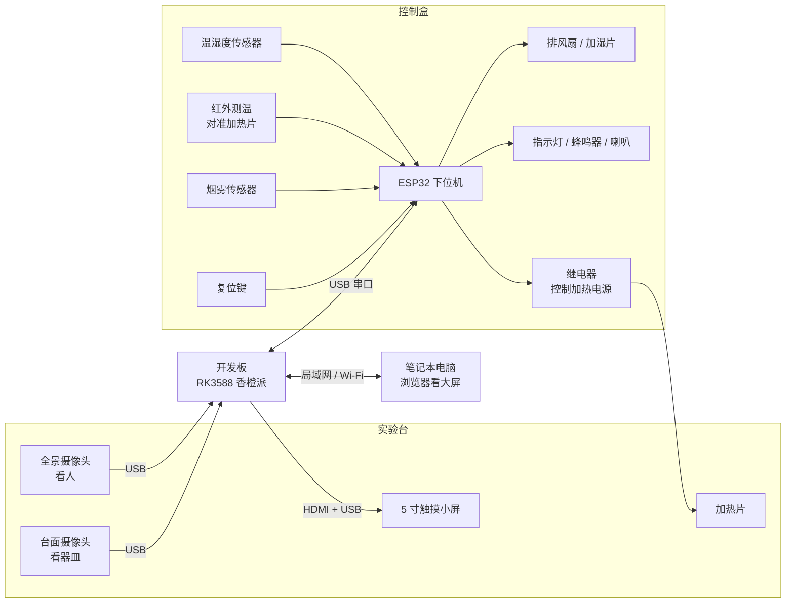

| 部件 | 干什么 | 放在哪 |
|---|---|---|
| 开发板（RK3588） | "大脑"：跑识别模型、做判断、显示小屏、提供网页大屏 | 实验台下 |
| 全景摄像头 | 看人：有没有人、有没有戴护目镜 / 手套 / 实验服 / 口罩、有没有吃东西 | 高处斜拍整个实验台 |
| 台面摄像头 | 看器皿：烧杯、量筒、容量瓶……有没有放在桌边 | 正对台面 |
| 5 寸触摸小屏 | 实验员身边的提示屏，戴手套也能点 | 实验台上 |
| ESP32 下位机 | "手脚"：读传感器、控制继电器、亮灯、响铃。**就算开发板死机，它自己也会断电** | 控制盒里 |
| 红外测温 | 不接触地测加热片 / 烧杯底的温度 | 对准加热片 2–5 cm |
| 温湿度、烟雾传感器 | 测环境温度、湿度、烟雾 | 控制盒上 |
| 继电器 | 一个电控开关，断开它加热片就没电了 | 控制盒里 |
| 复位键 | 断电后**唯一**能恢复通电的方法 | 控制盒面板 |
| 排风扇、加湿片 | 环境太热 / 太潮 / 有烟时排风，太干时加湿 | 控制盒旁 |
| 笔记本 | 打开浏览器看"网页大屏"（老师 / 管理员 / 评委用） | 任意位置，同一个 Wi-Fi 下 |

---

## 3. 三块屏幕分别给谁用

| 屏幕 | 给谁 | 用来干什么 | 怎么打开 |
|---|---|---|---|
| **实验台小屏** | 做实验的人 | 一眼看安全不安全；静音、呼叫、紧急断电 | 开发板开机自动全屏显示 |
| **网页大屏** | 老师、管理员、评委 | 看两路画面、调参数、和安全助手对话、看温度预测、控制排风、复核事件 | 浏览器打开 `http://开发板IP:8080` |
| **电脑大窗口** | 我们自己开发调试、没有开发板时演示 | 原来那套完整界面 | 电脑上运行 `python run_app.py` |

三块屏幕看到的是**同一份数据**：判断只在一个地方做（`src/core/engine.py`），屏幕只负责显示。所以关掉任何一块屏幕，安全判断照常进行。

---

## 4. 一次"烧干"是怎么被发现并处理的

```mermaid
flowchart TD
    A[摄像头画面] --> B[识别模型<br>有没有人 / 装备 / 器皿]
    C[传感器数据<br>温度 / 湿度 / 烟雾] --> D
    B --> D[安全核心<br>按规则逐条检查]
    C --> E[温度预测<br>多久沸腾 / 多久烧干]
    E --> D
    D --> F{结果}
    F -- 正常 --> G[绿色 · 继续盯着]
    F -- 警告 --> H[变黄 · 语音提醒<br>小屏 / 大屏显示原因]
    F -- 紧急 --> I[变红 · 发断电指令]
    I --> J[ESP32 断开继电器<br>回复"已断电"]
    J --> K[锁定：只能现场按复位键恢复]
    H --> L[安全助手生成处理建议<br>写在事件卡片上]
    I --> L
```

下面是同一次演示里的四个时刻（小屏截图）：

| ① 加热中，人离开了 | ② 水开了，温度停在 100℃ 左右 |
|---|---|
| 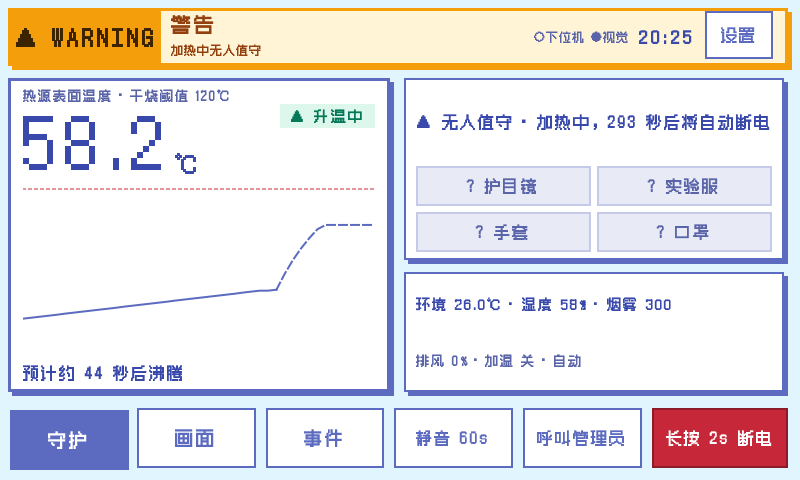 | 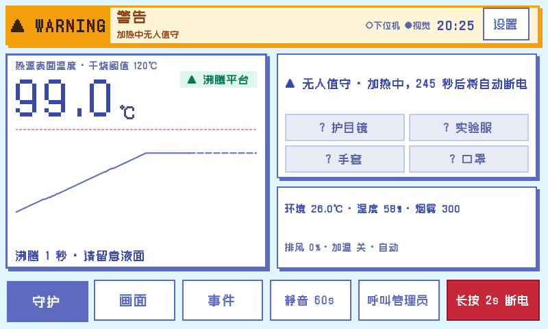 |
| **③ 越过沸点还在升温：快烧干了** | **④ 到达 120℃：自动断电并锁定** |
| 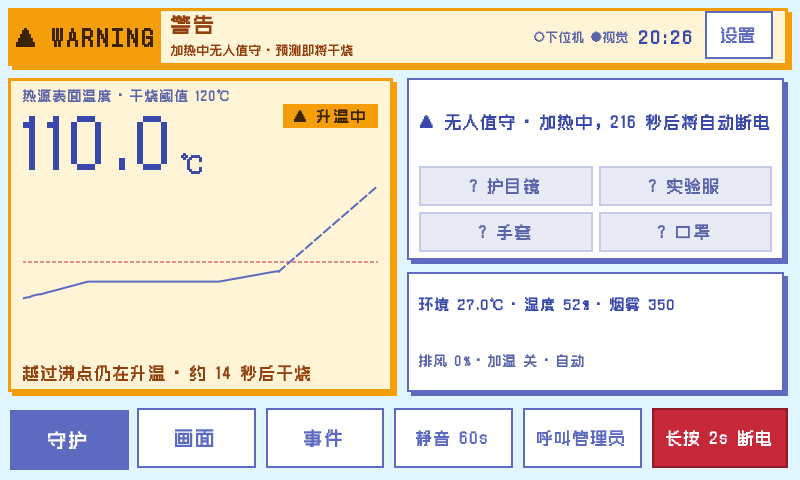 | 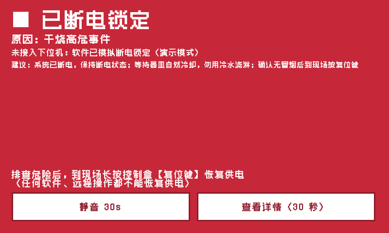 |

**温度预测是怎么想的？**（答辩常被问）

- 烧杯里还有水时，温度到 100℃ 左右就会停住，不会再涨。所以温度**没到沸点**时，系统只预测"多久后沸腾"，不会喊"要烧干了"。
- 温度**越过沸点还在涨**，说明水已经没了。这时才根据最近一分钟的升温曲线，算出"多久后到 120℃"，提前提醒。
- 一直在沸腾、人又不在，沸腾时间越长风险分越高，到 5 分钟也会提醒。
- 预测**只用来提醒，不会因为预测就断电**。断电只看实际温度和规则。

---

## 5. 实验台小屏逐页说明

小屏底部永远有 6 个大按钮：**守护 / 画面 / 事件**三个页面，加上 **静音 60s / 呼叫管理员 / 长按 2s 断电**三个操作。

### 5.1 守护页（默认页面）

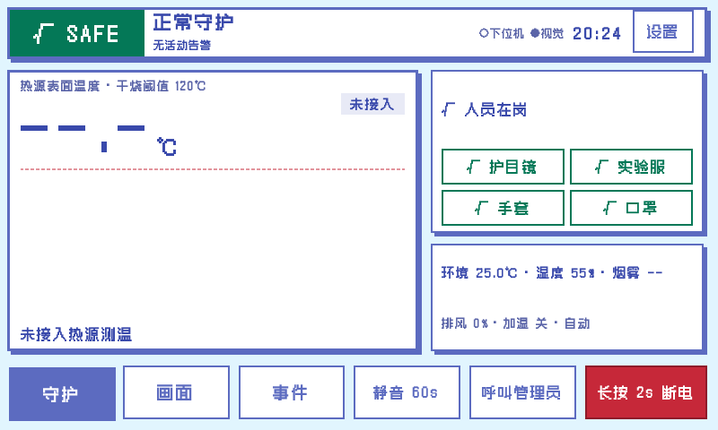

| 位置 | 内容 |
|---|---|
| 左上角色块 | 安全等级。绿色 √ SAFE = 正常；黄色 ▲ WARNING = 警告；红色 ■ CRITICAL = 紧急。**颜色 + 形状 + 文字**三种方式同时表示，色弱的人也能分清 |
| 顶栏右侧 | ●/○ 表示下位机和摄像头是否在线；时间；「设置」按钮 |
| 左边大框 | 加热片温度（大字）、温度曲线（实线是实测，虚线是预测，红色虚线是 120℃ 干烧线）、底部一行预测结论 |
| 右上 | 有没有人；四项防护装备：√ 戴了、■ 没戴、? 看不清（画面里没人） |
| 右下 | 环境温度、湿度、烟雾；排风扇和加湿片的状态 |

### 5.2 画面页

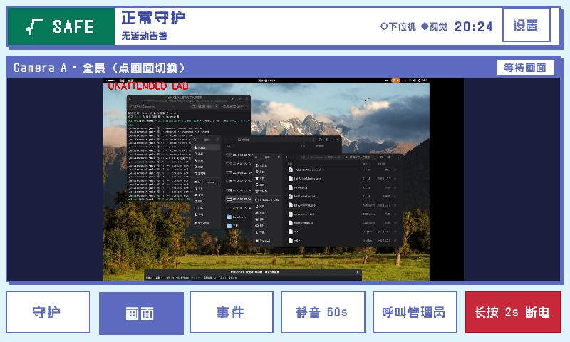

一次显示一路画面，**点一下画面切换**全景 / 台面。小屏只刷新到每秒 10 帧，省电。

### 5.3 事件页

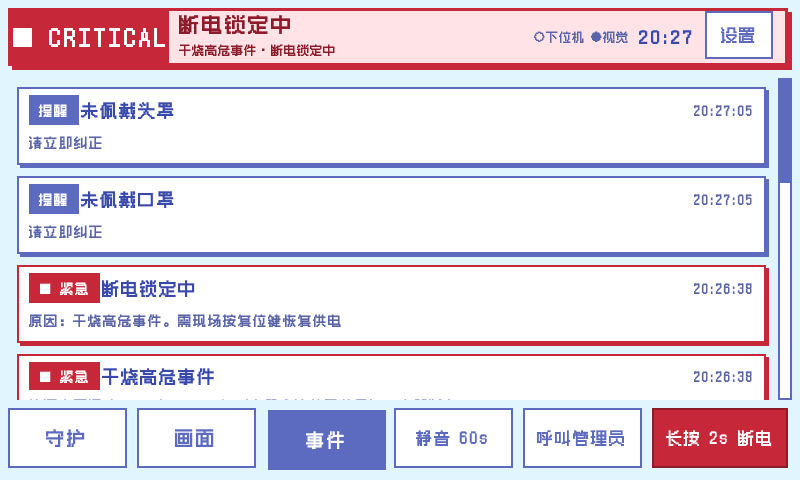

最近 10 条事件，大卡片显示。安全助手给出的处理建议会以"建议："开头显示在卡片里。

### 5.4 设置页

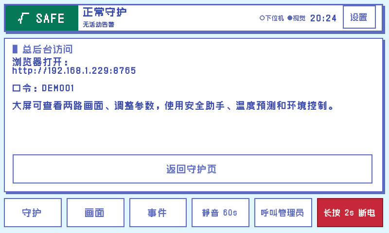

点顶栏「设置」进入。显示**网页大屏的地址和口令**，用笔记本打开网页时要用。

### 5.5 断电锁定时

断电后小屏整屏变红（见第 4 节图 ④），写明原因和"到现场按复位键"。可以点「查看详情（30 秒）」暂时收起红屏去看事件，30 秒后会再弹出。

### 5.6 三个操作按钮

| 按钮 | 作用 | 不会做什么 |
|---|---|---|
| 静音 60s | 60 秒内不播语音提醒（紧急状态最多 30 秒） | 不会解除告警、不会恢复通电 |
| 呼叫管理员 | 记一条"求助"事件，配置了企业微信 / 钉钉机器人就会推送 | — |
| 长按 2s 断电 | 按住 2 秒才生效，防止误触；立即切断加热电源 | 断电后小屏上**没有**"通电"按钮 |

---

## 6. 网页大屏逐页说明

在同一个 Wi-Fi 下，用浏览器打开 `http://开发板IP:8080`，输入小屏「设置」页上的 6 位口令。顶部有 6 个页签。

### 6.1 总览

正常时：

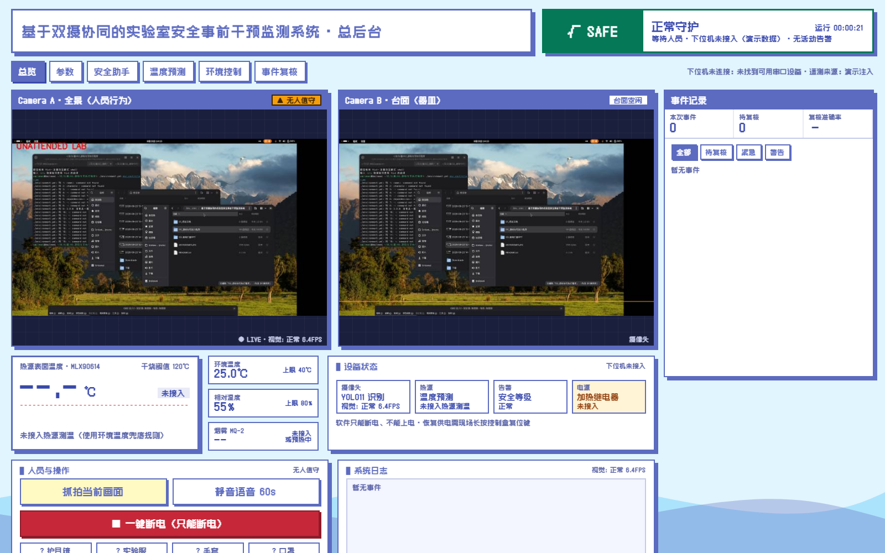

快烧干时：

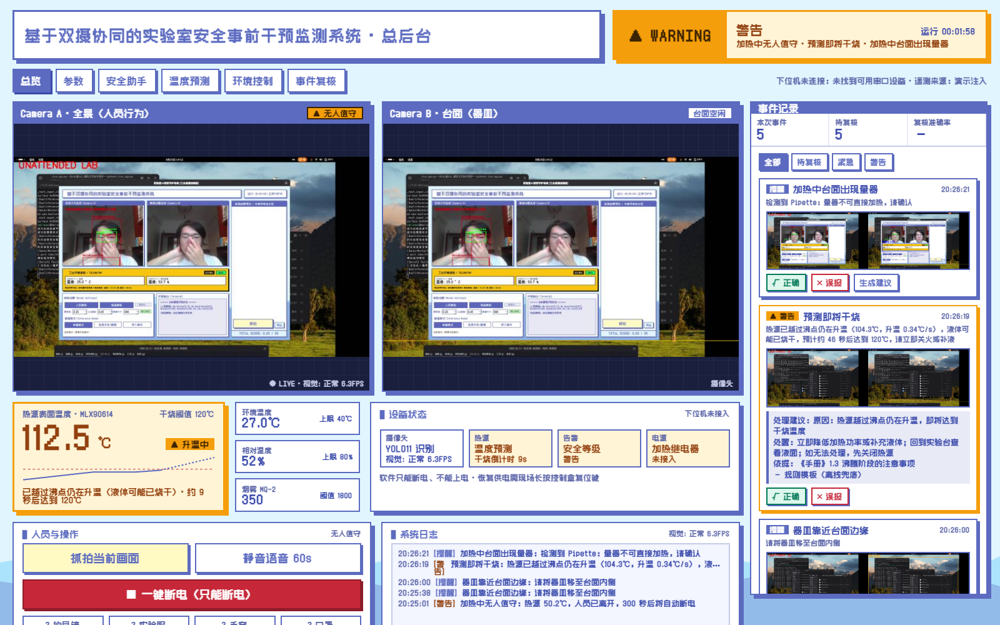

已断电：

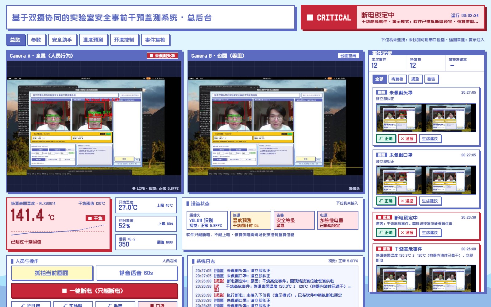

| 区域 | 内容 |
|---|---|
| 右上状态块 | 安全等级 + 原因 + 运行时长 |
| 两路画面 | 全景（看人）、台面（看器皿），右上角小标签是识别结论 |
| 热源温度块 | 和小屏一样：大字温度、曲线、预测结论 |
| 环境三格 | 环境温度、湿度、烟雾，超标会变色 |
| 设备状态 | 摄像头 / 温度预测 / 安全等级 / 加热电源 四项各自的状态 |
| 人员与操作 | 抓拍、静音、一键断电（会弹窗确认）；四项防护装备 |
| 系统日志 | 最近的事件，一行一条 |
| 右侧事件记录 | 每条事件一张卡片：截图、说明、处理建议；可以点「√ 正确」「× 误报」做复核 |

### 6.2 参数

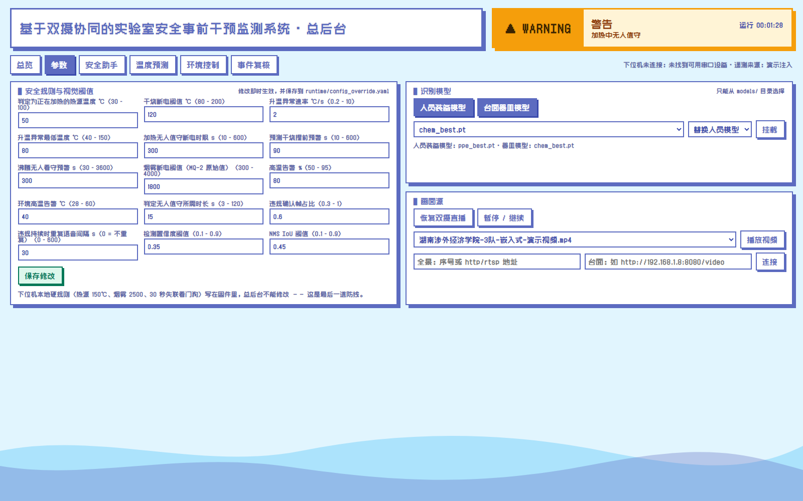

- 左边：所有安全阈值（干烧温度、无人值守多久断电、烟雾阈值……），每项都写了允许范围，填错会被拒绝。改完点「保存修改」立即生效，重启后也保留。
- 右上：开关两个识别模型；换模型（只能从 `models/` 文件夹选）。
- 右下：画面来源。可以切回摄像头、播放演示视频、或者填手机摄像头地址。
- **下位机里写死的保护（150℃、烟雾 2500、30 秒失联断电）在这里改不了**，这是最后一道防线。

### 6.3 安全助手

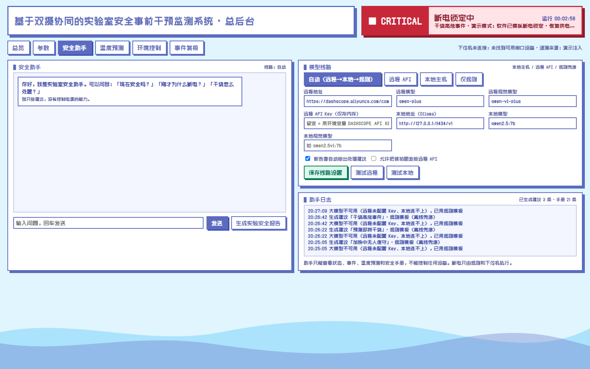

- 左边：可以直接问"现在安全吗？""刚才为什么断电？""干烧怎么处理？"，也可以一键生成"实验安全报告"。
- 右上：选择用哪个大模型（详见第 10 节）。
- 右下：助手日志，能看到它用了哪条线路、有没有出错。

### 6.4 温度预测

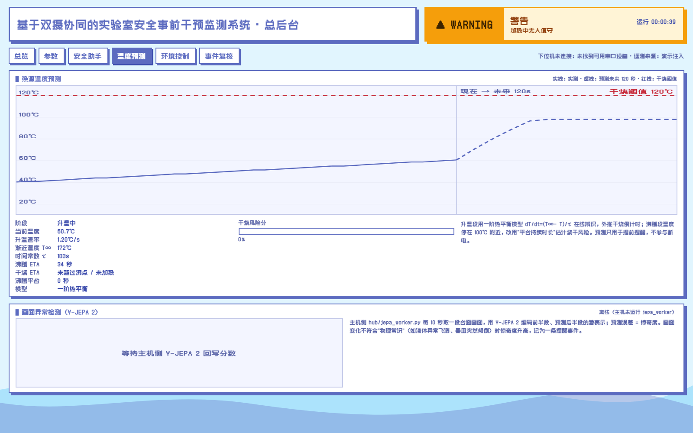

- 上图：左边实线是最近的实测温度，竖线右边虚线是对未来 120 秒的预测，红色虚线是干烧线。
- 下面列出：当前阶段、升温速度、预计最高温度、多久沸腾、多久烧干、风险分。
- 最下面"画面异常检测（V-JEPA 2）"是可选功能，需要在电脑上另外运行，没运行时显示"离线"，不影响其他功能。

### 6.5 环境控制

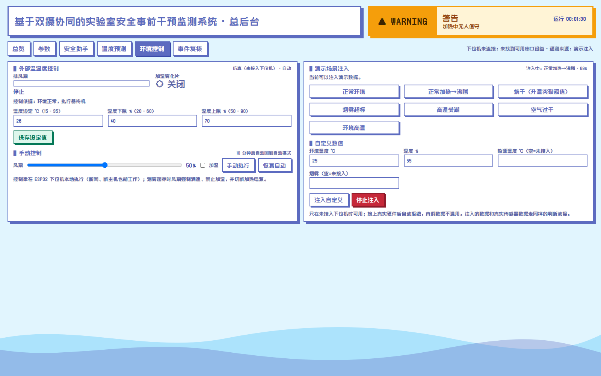

- 左边：排风扇转速、加湿片开关、为什么这样控制；可以改温度 / 湿度设定值，也可以临时手动控制（10 分钟后自动恢复自动）。
- 右边：**演示数据**——没接硬件时，用按钮模拟"正常加热""烧干""烟雾超标""高湿"等场景。接上真实硬件后会拒绝注入。

### 6.6 事件复核

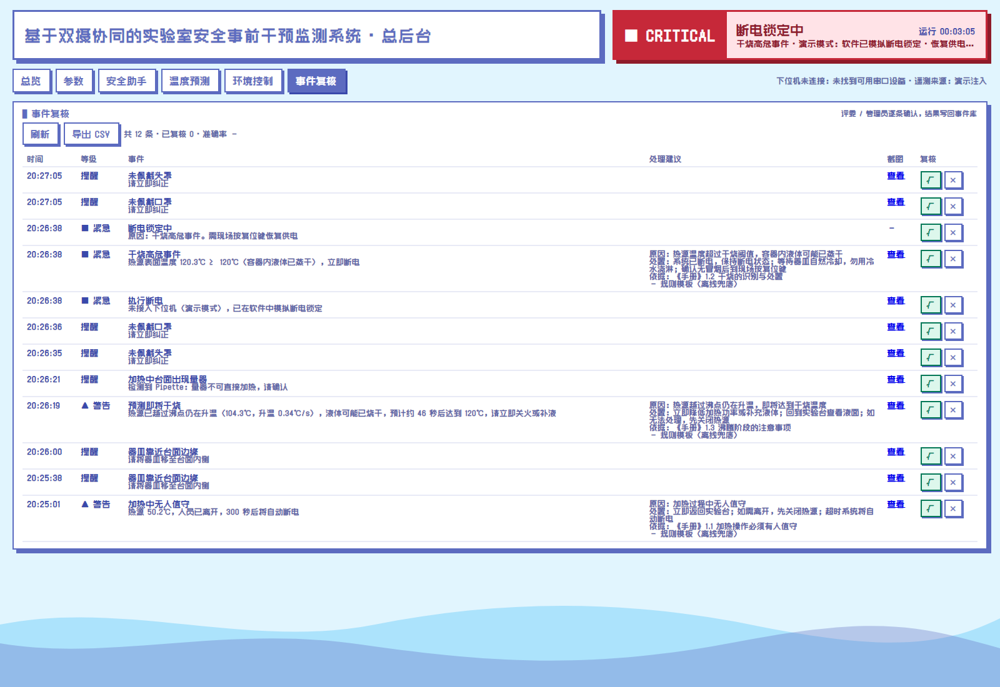

所有事件的表格。评委 / 老师逐条点 √ 或 ×，系统统计"复核准确率"，可以导出 CSV 表格。

---

## 7. 电脑大窗口

这是项目最早的完整界面，在电脑上开发调试、没有开发板时演示都用它。

| 正常 | 断电锁定 |
|---|---|
| 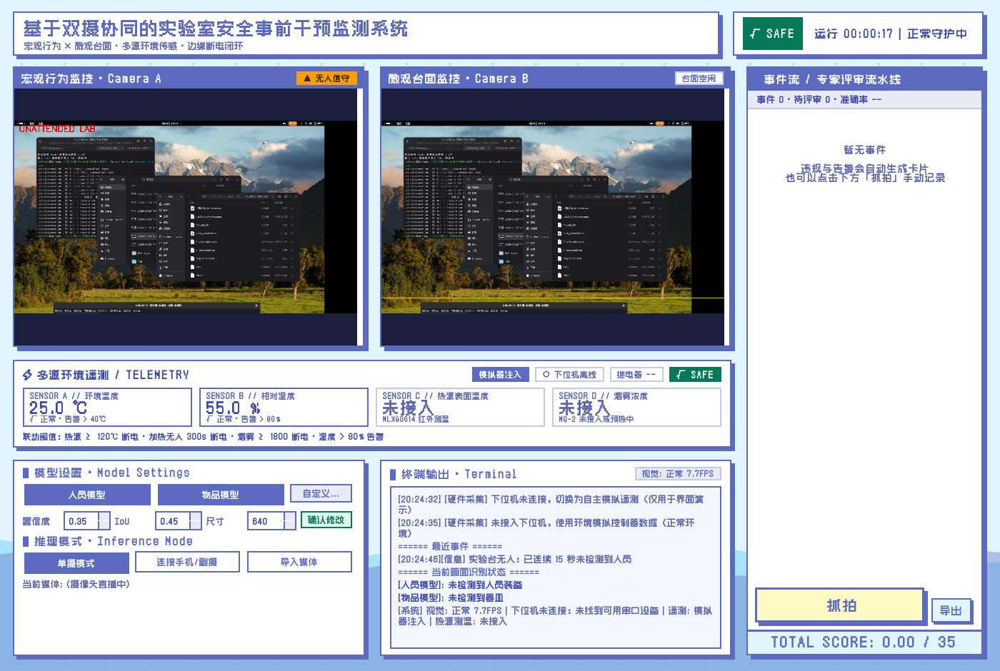 | 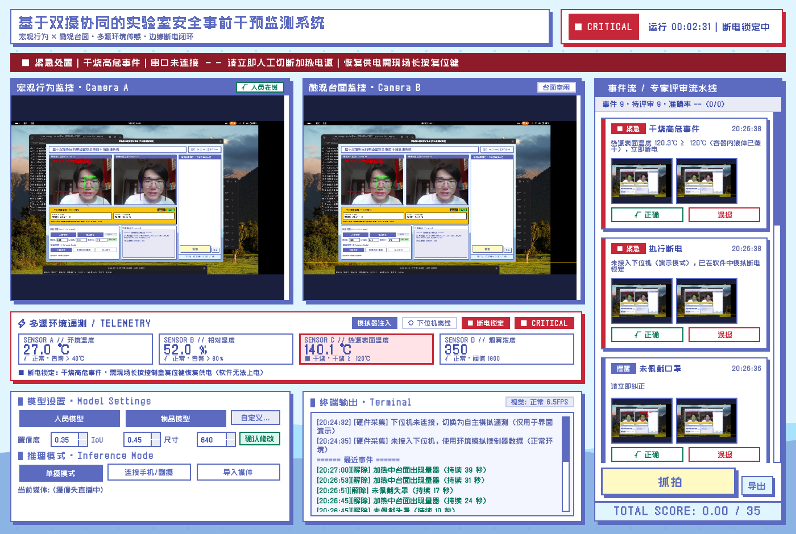 |

它和小屏、网页大屏用的是**同一个安全核心**。运行 `python run_app.py` 时，网页大屏也会同时启动。

---

## 8. 安全规则一览（大白话版）

阈值都可以在网页「参数」页或 `config.yaml` 里改。下表是默认值。

| 编号 | 什么情况 | 结果 |
|---|---|---|
| R1 干烧 | 加热片 ≥ 120℃ | **断电** |
| R2 升温太快 | ≥ 80℃ 且每秒升 2℃ 以上 | 警告 |
| R3 加热时没人 | 正在加热（≥ 50℃）且没人：先警告，持续 60 秒 | 警告 → **断电** |
| R4 兜底 | 没装红外测温时：台面有烧杯 + 没人 + 环境 > 55℃ | **断电** |
| R5 烟雾 | 烟雾读数 ≥ 1800 | **断电** |
| R6 太潮 | 湿度 > 80% | 警告 |
| R7 太热 | 环境温度 > 40℃ | 警告 |
| R8 量器被加热 | 正在加热时台面出现容量瓶 / 量筒等 | 提醒 |
| R9 快烧干了 | 越过沸点还在升温，预计 90 秒内到 120℃；或沸腾 5 分钟且没人 | 警告（**不断电**） |
| 视觉 | 没戴护目镜 / 手套 / 实验服 / 口罩、吃喝、趴桌、器皿靠桌边 | 提醒 / 警告 |

**下位机自己的规则**（不依赖开发板，开发板死机也照样执行）：

| 什么情况 | 结果 |
|---|---|
| 加热片 ≥ 150℃ | 断电 |
| 烟雾 ≥ 2500 | 断电 |
| 30 秒收不到开发板的心跳，而且还在加热 | 断电 |
| 刚上电 | 继电器默认断开 |

一个识别结果要在 3 秒内**六成以上的画面都成立**才算数，避免某一帧看错就乱报。同一件事解除后 10 秒内又出现，算作同一次，不会反复刷屏、反复播报。

---

## 9. 为什么"软件只能断电，不能通电"

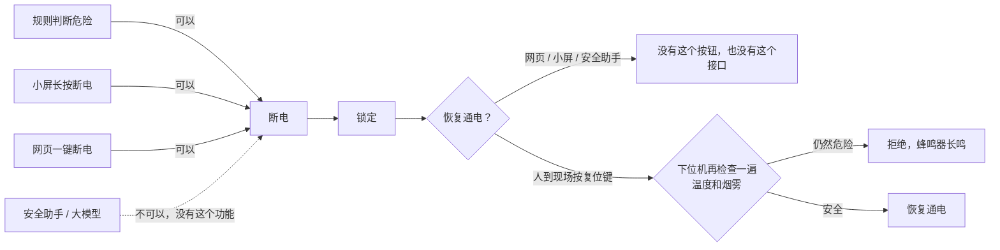

道理很简单：断电是安全的方向，谁都可以按；通电是危险的方向，必须有人在现场亲眼确认。所以：

- 程序里**根本没有**"通电"的接口（有测试专门检查这一点）。
- 安全助手（大模型）**连断电都不能做**，它只能看、只能给建议。大模型可能会说错话，所以不让它碰任何开关。
- 复位键按下后，下位机还会再检查一遍温度和烟雾，危险没解除就拒绝通电。

---

## 10. 安全助手是怎么工作的

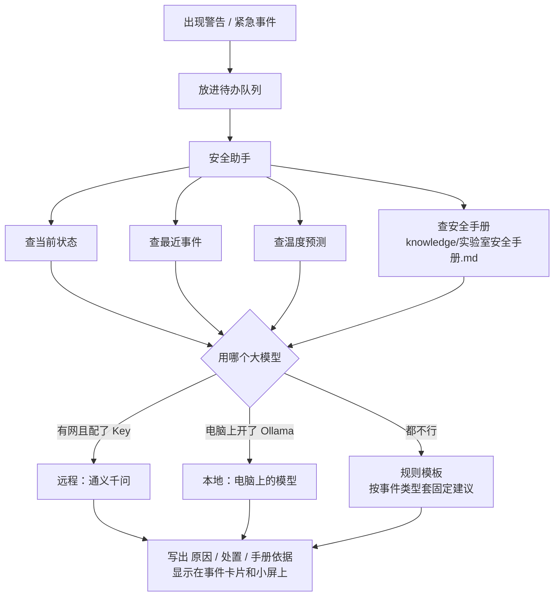

**三条线路，自动选能用的那条：**

| 线路 | 需要什么 | 适合 |
|---|---|---|
| 远程（通义千问） | 能上网 + 一个 DashScope API Key | 效果最好 |
| 本地（Ollama） | 一台装了 Ollama 的电脑，和开发板在同一个 Wi-Fi | 现场没网时 |
| 规则模板 | 什么都不需要 | 兜底，保证断网也有建议 |

**怎么配置远程 Key：**

1. 在阿里云百炼（DashScope）控制台申请 API Key。
2. 二选一：
   - 在开发板 / 电脑上设置环境变量 `DASHSCOPE_API_KEY=你的Key`，然后启动程序；
   - 或者在网页「安全助手」页的"远程 API Key"框里填（**只存在内存里，重启要重新填**，不会写进任何文件）。
3. 点「测试远程」，显示"在线"就好了。

**Key 千万不要写进 `config.yaml`，也不要提交到 GitHub。**

**怎么配置本地 Ollama：**

1. 在电脑上安装 Ollama，运行：
   ```bash
   ollama pull qwen2.5:7b
   ```
2. 网页「安全助手」页把"本地地址"改成 `http://电脑的局域网IP:11434/v1`，保存，点「测试本地」。

**隐私：** 默认**不会**把事件截图发给远程 API，只发文字描述。需要的话在页面上勾选"允许把抓拍图发给远程 API"。

**安全手册：** 助手引用的条款来自 `labguard/knowledge/实验室安全手册.md`，每个"## 标题"是一条。可以按我们学校的实验室制度修改。

---

## 11. 在自己电脑上跑起来

**准备：** 安装 Python 3.10–3.12（安装时勾选 "Add Python to PATH"）。

**第 1 步：打开终端，进入源码文件夹**

```bash
cd labguard
```

**第 2 步：安装依赖（只需要做一次）**

```bash
pip install -r requirements.txt
```

**第 3 步：启动（电脑大窗口 + 网页大屏）**

```bash
python run_app.py
```

终端里会打印一行"总后台已启动……口令 XXXXXX"。用浏览器打开 `http://127.0.0.1:8080`，输入这个口令。口令也保存在 `runtime/web_token.txt`。

**想在电脑上看小屏界面：**

```bash
python run_app.py --mode edge --windowed
```

**跑测试（改完代码后一定要跑）：**

```bash
python tests/test_backend.py
```

```bash
python tests/test_platform.py
```

两个都显示"全部通过"才算没改坏。

**三种运行模式：**

| 命令 | 显示 | 用在 |
|---|---|---|
| `python run_app.py` | 电脑大窗口 + 网页 | 电脑开发、演示 |
| `python run_app.py --mode edge` | 小屏全屏 + 网页 | 开发板正式运行（开机自启用的就是它） |
| `python run_app.py --mode headless` | 只有网页 | 开发板没接屏幕时 |

---

## 12. 没有硬件时怎么演示

1. 启动程序。没有摄像头时，到网页「参数」页 →「画面源」选演示视频，点「播放视频」。演示视频放在 `labguard/media/` 或仓库根目录的 `local_private/` 文件夹里（这两个位置都不会上传 GitHub）。
2. 到网页「环境控制」页 → 右边「演示数据」，按顺序点：
   - **正常加热→沸腾**：温度从 40℃ 升到 99℃ 停住；
   - **烧干**：在 99℃ 停一会儿后继续升温，越过 120℃ 触发断电；
   - **烟雾超标**、**高湿受潮**、**环境高温**：分别触发对应规则。
3. 演完点「停止注入」。

没接下位机时，断电是"软件模拟断电"，危险解除 10 秒后自动解锁，方便连续演示。**接上真实下位机后，演示数据会被拒绝**（真假数据不混用），断电后必须按复位键才能恢复。

---

## 13. 文件夹地图

只列出需要了解的部分。

```
labguard/
├─ run_app.py                启动入口
├─ config.yaml               所有阈值和设置（改这里不用改代码）
├─ models/                   识别模型：ppe_best.pt（人员装备）、chem_best.pt（器皿）
├─ knowledge/                安全助手用的安全手册
├─ LabSafetyMonitor/
│   ├─ dual_inference.py     读摄像头、跑识别模型
│   └─ serial_comm.py        和下位机通信
├─ src/
│   ├─ core/                 安全核心（最重要）
│   │   ├─ engine.py         把识别和传感器数据交给规则判断
│   │   ├─ state_machine.py  安全规则 R1–R9、断电和锁定
│   │   ├─ world_model.py    温度预测
│   │   ├─ events.py         事件记录、截图、语音、数据库
│   │   ├─ env_control.py    排风扇、加湿片
│   │   └─ demo.py           演示数据
│   ├─ agent/                安全助手
│   ├─ web/                  网页大屏（static/ 里是网页文件）
│   └─ ui/
│       ├─ main_window.py    电脑大窗口
│       └─ kiosk.py          实验台小屏
├─ firmware/lab_guard_esp32/ ESP32 下位机程序（用 Arduino IDE 烧录）
├─ deploy/orangepi/          开发板安装脚本、开机自启
├─ tools/                    串口调试、模型转换、生成语音文件
├─ tests/                    自动测试
└─ runtime/                  运行时自动生成：事件数据库、截图、口令（不会上传 GitHub）
```

---

## 14. 常见问题

**Q：网页打不开？**
看三点：程序有没有在运行；电脑和开发板是不是同一个 Wi-Fi；地址里的 IP 对不对（小屏「设置」页能看到）。

**Q：网页提示口令错误？**
口令在小屏「设置」页或 `runtime/web_token.txt`。删掉这个文件再重启，会生成新口令。

**Q：画面显示 NO SIGNAL？**
摄像头没接好或编号不对。在 `config.yaml` 的 `camera` 里改 `pano` / `desk` 的编号（0、1、2……），或者先用演示视频。

**Q：显示"视觉离线"？**
识别模型没加载成功。检查 `models/` 文件夹里有没有两个 `.pt` 文件。

**Q：安全助手一直显示"规则模板"？**
说明远程和本地都没连上。去网页「安全助手」页分别点「测试远程」「测试本地」，看具体原因。断网时用规则模板是正常的。

**Q：断电后怎么恢复？**
接了下位机：到现场确认安全，长按控制盒上的复位键 1 秒。没接下位机（演示）：危险解除 10 秒后自动解锁。

**Q：改了阈值不生效？**
网页「参数」页改的立即生效。直接改 `config.yaml` 要重启程序。注意网页改过的值保存在 `runtime/config_override.yaml`，它会覆盖 `config.yaml` 里的同名项。

**Q：测试没通过？**
把终端里打印的报错完整发到群里，不要自己删测试。

---

## 15. 名词解释

| 名词 | 意思 |
|---|---|
| YOLO11 | 一种识别图片里物体的模型，我们用它认人身上的装备和台面上的器皿 |
| NPU | 开发板上专门跑识别模型的芯片，比 CPU 快很多、更省电 |
| RKNN | 把模型转换成 RK3588 NPU 能跑的格式 |
| 下位机 | 控制盒里的 ESP32，负责直接控制硬件；开发板叫"上位机" |
| 继电器 | 用电信号控制的开关，断开后加热片就没电 |
| 心跳 | 开发板每秒给下位机发一条"我还活着"；断了 30 秒下位机就自己断电 |
| 锁定 | 断电后保持断电状态，直到有人按复位键 |
| 投票 | 一个识别结果要在 3 秒内六成以上的画面成立才算数，防止误报 |
| 温度预测 | 根据最近的温度变化算出"多久沸腾 / 多久烧干" |
| 安全助手 / Agent | 能查资料、给建议的大模型程序。只能看、不能控制设备 |
| 通义千问 / DashScope | 阿里的大模型和它的接口平台（远程线路） |
| Ollama | 在自己电脑上运行大模型的软件（本地线路） |
| V-JEPA 2 | Meta 发布的视频模型，能预测"画面接下来会怎样"，预测不准就说明画面里发生了不寻常的事。我们把它作为可选的画面异常检测 |
| 口令 / token | 打开网页大屏要输入的 6 位密码 |
| 演示数据 | 没接硬件时，用程序模拟传感器数值，用来演示 |
